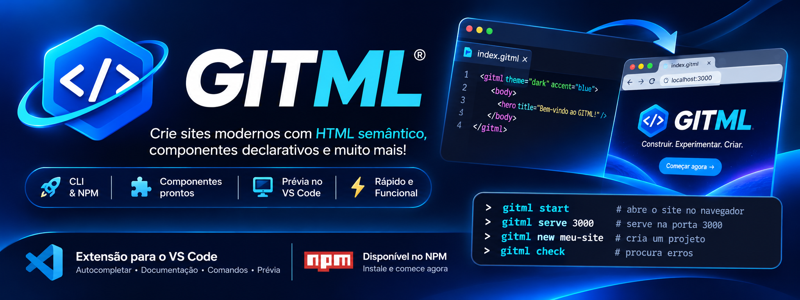

<p align="center">
  
</p>

<p align="center">
  
</p>

<h1 align="center">GITML</h1>

<p align="center">
  <strong>Da ideia ao navegador, com uma linguagem declarativa.</strong><br>
  Crie sites modernos com componentes, HTML semântico e ferramentas integradas.
</p>

<p align="center">
  <a href="https://www.npmjs.com/package/gitml">
    
  </a>
  <a href="#-cli--terminal">
    
  </a>
  <a href="#-extensão-do-vs-code">
    
  </a>
</p>

<p align="center">
  <a href="#-sua-primeira-página">
    
  </a>
  <a href="#-o-que-é-gitml">
    
  </a>
  <a href="https://nodejs.org/">
    
  </a>
  <a href="LICENSE">
    
  </a>
</p>

<p align="center">
  <a href="https://www.npmjs.com/package/gitml">
    
  </a>
  <a href="https://github.com/Gislaine-web3/gitml-language-npm/stargazers">
    
  </a>
  <a href="https://github.com/Gislaine-web3/gitml-language-npm/issues">
    
  </a>
</p>

<p align="center">
  <a href="#-comece-aqui">Comece aqui</a>
  &nbsp; • &nbsp;
  <a href="#-sua-primeira-página">Exemplo</a>
  &nbsp; • &nbsp;
  <a href="#-comandos">Comandos</a>
  &nbsp; • &nbsp;
  <a href="https://www.npmjs.com/package/gitml">npm</a>
  &nbsp; • &nbsp;
  <a href="https://github.com/Gislaine-web3/gitml-language-npm/issues">Reportar problema</a>
</p>

---

## ✨ O que é GITML?

GITML é uma linguagem declarativa para criar páginas modernas usando componentes e uma estrutura independente ou com o HTML.

Este repositório reúne as ferramentas do projeto:

| Ferramenta | Para que serve |
| :--- | :--- |
| 🧩 Motor GITML | Interpreta e transforma a marcação GITML |
| ⚡ CLI | Cria projetos, inicia o servidor, verifica e gera o site |
| 💻 Extensão do VS Code | Integra o trabalho com arquivos `.gitml` ao editor |
| 🎨 Sites de exemplo | Mostram a linguagem em projetos prontos para explorar |

> Um ecossistema para escrever, visualizar e desenvolver seus sites com GITML.

## 📚 Navegação

- [🚀 Comece aqui](#-comece-aqui)
- [💻 Extensão do VS Code](#-extensão-do-vs-code)
- [⚡ CLI — terminal](#-cli--terminal)
- [🛠️ Crie seu projeto](#️-crie-seu-projeto)
- [🎨 Sua primeira página](#-sua-primeira-página)
- [🌐 Sites prontos para testar](#-sites-prontos-para-testar)
- [📋 Comandos](#-comandos)
- [🤝 Contribua](#-contribua)
- [🌱 Ecossistema GBit](#-ecossistema-gbit)
- [📄 Licença](#-licença)

## 🚀 Comece aqui

### Requisito

Instale o [Node.js](https://nodejs.org/) **16 ou superior**.

Confira a instalação no terminal:

```bash
node --version
npm --version
```

Escolha como deseja trabalhar:

- **VS Code:** instale a extensão para usar o GITML dentro do editor.
- **Terminal:** instale o pacote npm e utilize a CLI.

## 💻 Extensão do VS Code

### Instalação pelo arquivo VSIX

1. Abra o VS Code.
2. Acesse **Extensions** com `Ctrl + Shift + X`.
3. Clique no menu `⋯`.
4. Selecione **Install from VSIX...**.
5. Escolha o arquivo `gitml-0.4.2.vsix` fornecido com o projeto.

> Se o arquivo disponível tiver outra versão, selecione o `.vsix` correspondente.

### Abrir seu site

Abra um arquivo `.gitml` e use o botão **🌐** da extensão para visualizar o site no navegador.

Você também pode iniciar pelo terminal integrado:

```bash
gitml start
```

Ou informar o arquivo:

```bash
gitml start index.gitml
```

## ⚡ CLI — terminal

### Instalação global

Para disponibilizar o comando `gitml` no terminal:

```bash
npm install -g gitml
```

### Instalação local

Para adicionar o pacote somente ao projeto:

```bash
npm install gitml
```

Nesse caso, execute a CLI com `npx`:

```bash
npx gitml start index.gitml
```

### Iniciar o site e abrir o navegador

Dentro da pasta do projeto:

```bash
gitml start
```

Para abrir um arquivo específico:

```bash
gitml start index.gitml
```

### Iniciar apenas o servidor

```bash
gitml serve 3000
```

Para escolher a porta e o arquivo:

```bash
gitml serve 3000 loja.gitml
```

> Nos exemplos seguintes, `gitml` considera a instalação global. Se instalou localmente, use `npx gitml`.

## 🛠️ Crie seu projeto

Crie uma nova estrutura:

```bash
gitml new meu-projeto
```

Entre na pasta e inicie:

```bash
cd meu-projeto
gitml start
```

## 🎨 Sua primeira página

Crie um arquivo chamado `index.gitml`:

```html
<gitml
  theme="dark"
  accent="#2563eb"
  font="manrope"
  lang="pt-BR"
  title="Meu primeiro site com GITML"
>

  <nav brand="Meu Projeto">
    <link href="#recursos">Recursos</link>
    <link href="#sobre">Sobre</link>
    <button href="#recursos" variant="primary">
      Explorar
    </button>
  </nav>

  <hero
    eyebrow="FEITO COM GITML"
    title="Sua próxima ideia começa **aqui.**"
    subtitle="Uma página declarativa com navegação, componentes e personalidade."
    cta="Conhecer os recursos"
    href="#recursos"
  />

  <section
    id="recursos"
    title="Menos repetição. Mais criação."
    subtitle="Organize sua página com componentes."
  >
    <grid cols="3" gap="22">

      <card title="Componentes" icon="layers">
        <p>
          Combine cards, seções, botões e outros elementos.
        </p>
      </card>

      <card title="Seu estilo" icon="sparkles">
        <p>
          Personalize a apresentação da sua página.
        </p>
      </card>

      <card title="Do arquivo ao site" icon="globe">
        <p>
          Inicie o servidor e visualize no navegador.
        </p>
      </card>

    </grid>
  </section>

  <section id="sobre" title="Uma ideia, muitas possibilidades.">
    <p>
      Este é o ponto de partida para criar seu site com GITML.
    </p>
  </section>

  <footer brand="Meu Projeto">
    <p>Criado com GITML.</p>
    <link href="#recursos">Voltar aos recursos</link>
  </footer>

</gitml>
```

Depois, execute:

```bash
gitml start index.gitml
```

## 🌐 Sites prontos para testar

Os exemplos abaixo consideram que você está na raiz do repositório.

### 🪐 Orbit — exemplo SaaS

Projeto com rotas, estado e gráficos:

```bash
cd sites-de-teste/orbit-site
gitml start
```

### 🛍️ Nativa — loja demonstrativa

Na raiz do repositório:

```bash
gitml start loja.gitml
```

### 🎬 TelaPlay — página demonstrativa

Na raiz do repositório:

```bash
gitml start index.gitml
```

> Os exemplos permitem explorar a linguagem. Recursos demonstrativos não significam que há pagamentos, contas ou serviços de produção conectados.

## 📋 Comandos

| Comando | O que faz |
| :--- | :--- |
| `gitml start [arquivo\|pasta\|porta]` | Inicia o servidor e abre o navegador |
| `gitml serve [porta]` | Inicia somente o servidor |
| `gitml serve 3000 loja.gitml` | Serve um arquivo específico na porta indicada |
| `gitml new <nome>` | Cria um projeto |
| `gitml check [arquivos]` | Procura erros nos arquivos |
| `gitml build [arquivo]` | Gera a saída em `dist/` |
| `gitml fmt <arquivo>` | Formata um arquivo |
| `gitml components` | Lista os componentes disponíveis |

### Exemplos rápidos

```bash
# Abrir uma página no navegador
gitml start index.gitml

# Iniciar somente o servidor
gitml serve 3000

# Verificar a página
gitml check index.gitml

# Formatar o arquivo
gitml fmt index.gitml

# Gerar o site
gitml build index.gitml

# Explorar os componentes
gitml components
```

## 🤝 Contribua

Encontrou um problema ou tem uma ideia?

- 🐛 Abra uma issue com os passos para reproduzir o erro.
- 💡 Sugira melhorias para a linguagem, CLI ou extensão.
- 🧩 Compartilhe exemplos de páginas em GITML.
- 📝 Ajude a melhorar a documentação.

Ao reportar um problema, informe:

- Versão do Node.js.
- Versão do GITML.
- Sistema operacional.
- Comando executado.
- Mensagem de erro.
- Um exemplo mínimo do arquivo, quando possível.

> Nunca inclua tokens npm, senhas ou outras credenciais em issues, exemplos ou commits.

[Reportar um problema →](https://github.com/Gislaine-web3/gitml-language-npm/issues)

## 🌱 Ecossistema GBit

GITML faz parte do ecossistema **GBit**, criado por **Gislaine-web3**.

Uma iniciativa que conecta linguagem, ferramentas e experimentação para transformar ideias em projetos.

| Projeto | Papel |
| :--- | :--- |
| GITML | Linguagem e componentes para páginas |
| GITML CLI | Ferramentas de desenvolvimento no terminal |
| Extensão VS Code | Integração com o editor |
| GBit Shell | Ambiente de terminal do ecossistema |

## 👩‍💻 Autora

Criado por **Gislaine-web3**.

- [Perfil no GitHub](https://github.com/Gislaine-web3)
- [Repositório GITML](https://github.com/Gislaine-web3/gitml-language-npm)
- [Pacote no npm](https://www.npmjs.com/package/gitml)

## 📄 Licença

Distribuído sob a licença **MIT**.

Consulte o arquivo [LICENSE](LICENSE) para mais informações.

---

<p align="center">
  <strong>GITML · Crie. Visualize. Evolua.</strong><br>
  Uma linguagem do ecossistema GBit.
</p>

<p align="center">
  <a href="#gitml">↑ Voltar ao topo</a>
</p>

