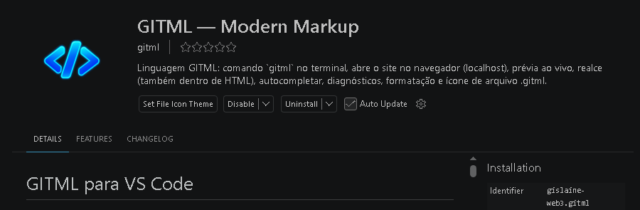

<p align="center">
  
</p>

<h1 align="center">GITML</h1>

<p align="center">
  <strong>Crie sites modernos com GITML puro.</strong><br>
  HTML semântico, componentes declarativos, CLI e extensão para VS Code. 
</p>

<p align="center">
  <a href="https://github.com/Gislaine-web3/gitml-language-NPM">
    
  </a>
  <a href="https://github.com/Gislaine-web3/gitml-language-NPM/blob/main/LICENSE">
    
  </a>
  <a href="https://github.com/Gislaine-web3/gitml-language-NPM/tree/main/bin">
    
  </a>
  <a href="https://github.com/Gislaine-web3/gitml-language-NPM/tree/main/vscode-extension">
    
  </a>
  <a href="https://github.com/Gislaine-web3/gitml-language-NPM">
    
  </a>
</p>

<p align="center">
  <a href="https://github.com/Gislaine-web3/gitml-language-NPM">Código-fonte</a>
  &nbsp; · &nbsp;
  <a href="https://github.com/Gislaine-web3/gitml-language-NPM/tree/main/vscode-extension">Extensão VS Code</a>
  &nbsp; · &nbsp;
 
</p>
  <p align="center">
  <a href="https://www.npmjs.com/package/gitml">
    
  </a>
  <a href="#-cli--terminal">
    
  </a>
  <a href="#-extensão-do-vs-code">
    
  </a>
</p>

<p align="center">
  <a href="#-sua-primeira-página">
    
  </a>
  <a href="#-o-que-é-gitml">
    
  </a>
  <a href="https://nodejs.org/">
    
  </a>
  <a href="LICENSE">
    
  </a>
</p>

<p align="center">
  <a href="https://www.npmjs.com/package/gitml">
    
  </a>
  <a href="https://github.com/Gislaine-web3/gitml-language-npm/stargazers">
    
  </a>
  <a href="https://github.com/Gislaine-web3/gitml-language-npm/issues">
    
  </a>
</p>

<p align="center">
  <a href="#-comece-aqui">Comece aqui</a>
  &nbsp; • &nbsp;
  <a href="#-sua-primeira-página">Exemplo</a>
  &nbsp; • &nbsp;
  <a href="#-comandos">Comandos</a>
  &nbsp; • &nbsp;
  <a href="https://www.npmjs.com/package/gitml">npm</a>
  &nbsp; • &nbsp;
  <a href="https://github.com/Gislaine-web3/gitml-language-npm/issues">Reportar problema</a>
</p>
---

 
# GITML — Linguagem de Marcação para Interfaces Web

**Crie sites modernos usando uma sintaxe simples, componentes declarativos e HTML semântico.**

GITML é uma linguagem de marcação criada para facilitar o desenvolvimento de interfaces web. Ela combina elementos familiares do HTML5 com componentes próprios, recursos declarativos, estados reativos e ferramentas para acelerar a criação de páginas.

Com GITML, você pode construir landing pages, dashboards, lojas virtuais, portfólios, sites institucionais e interfaces modernas sem precisar escrever JavaScript para cada interação visual.

---

## ✨ O que é GITML?

GITML é uma linguagem declarativa para criar páginas modernas usando componentes e uma estrutura independente ou com o HTML.

Este repositório reúne as ferramentas do projeto:

| Ferramenta | Para que serve |
| :--- | :--- |
| 🧩 Motor GITML | Interpreta e transforma a marcação GITML |
| ⚡ CLI | Cria projetos, inicia o servidor, verifica e gera o site |
| 💻 Extensão do VS Code | Integra o trabalho com arquivos `.gitml` ao editor |
| 🎨 Sites de exemplo | Mostram a linguagem em projetos prontos para explorar |

> Um ecossistema para escrever, visualizar e desenvolver seus sites com GITML.

## 📚 Navegação

- [🚀 Comece aqui](#-comece-aqui)
- [💻 Extensão do VS Code](#-extensão-do-vs-code)
- [⚡ CLI — terminal](#-cli--terminal)
- [🛠️ Crie seu projeto](#️-crie-seu-projeto)
- [🎨 Sua primeira página](#-sua-primeira-página)
- [🌐 Sites prontos para testar](#-sites-prontos-para-testar)
- [📋 Comandos](#-comandos)
- [🤝 Contribua](#-contribua)
- [🌱 Ecossistema GBit](#-ecossistema-gbit)
- [📄 Licença](#-licença)


---

## ✨ Principais recursos

- **HTML semântico:** suporte a `header`, `nav`, `main`, `section`, `article`, `aside`, `footer`, `figure` e outros elementos.
- **Componentes prontos:** cards, botões, badges, métricas, tabelas, gráficos e muito mais.
- **Navegação:** links, menus, dropdowns, abas e navegação por âncoras.
- **Interatividade declarativa:** estados, ações, formulários, notificações e componentes interativos.
- **Design:** temas, cores, fontes, espaçamentos, animações e variantes visuais.
- **Responsividade:** grades e layouts adaptáveis.
- **Gráficos e dados:** charts, sparklines, métricas e indicadores.
- **Acessibilidade:** estrutura semântica, textos alternativos e identificação de campos.
- **VS Code:** autocompletar, documentação de componentes, hover, diagnósticos e prévia.
- **CLI:** execução e visualização local dos projetos.


  Escolha como deseja trabalhar:

- **VS Code:** instale a extensão para usar o GITML dentro do editor.
- **Terminal:** instale o pacote npm e utilize a CLI.

  <p align="center">
  
</p>


## Modo de uso: 


## 💻 Extensão do VS Code


 Pressione Ctrl + Shift + X, procure GITML e abra a extensão.

Pronto! 🚀

## ou instalar a extensao no terminal


```bash
code --install-extension gislaine-web3.gitml
```


### Abrir seu site

Abra um arquivo `index.gitml` e use o botão **🌐** da extensão para visualizar o site no navegador.

Você também pode iniciar pelo terminal integrado:

```bash
gitml start
```

Ou informar o arquivo:

```bash
gitml start index.gitml
```

## ⚡ CLI — terminal


### Instalação global

Para disponibilizar o comando `gitml` no terminal:

## 🖥️ Executar 0 pacote NPM:

```bash
npm install -g gitml
```

### Instalação local

Para adicionar o pacote somente ao projeto:

```bash
npm install gitml
```

Nesse caso, execute a CLI com `npx`:

```bash
npx gitml start index.gitml
```

### Iniciar o site e abrir o navegador

Dentro da pasta do projeto:

```bash
gitml start
```

Para abrir um arquivo específico:

```bash
gitml start index.gitml
```

### Iniciar apenas o servidor

```bash
gitml serve 3000
```

Para escolher a porta e o arquivo:

```bash
gitml serve 3000 loja.gitml
```

> Nos exemplos seguintes, `gitml` considera a instalação global. Se instalou localmente, use `npx gitml`.

## 🛠️ Crie seu projeto em um comando

Crie uma nova estrutura:

```bash
gitml new meu-projeto
```

Entre na pasta e inicie:

```bash
cd meu-projeto
gitml dev
```


## 📦 Estrutura de um projeto

Um projeto GITML pode ser organizado assim:

```text
meu-projeto/
├── index.gitml
├── pages/
│   ├── sobre.gitml
│   └── contato.gitml
├── assets/
│   ├── images/
│   └── icons/
└── README.md
```


## Destaque: Crypto Platform criado com gitml puro

Dashboard responsivo de criptoativos, escrito em GITML puro em index.gitml. O gráfico BTC/USDT é incorporado do TradingView; os valores de saldo e da lista de ativos.


<p align="center">
  
</p>


## Site feito com gitml puro  

<p align="center">
  
</p>


## 🎨 Sua primeira página

Crie um arquivo chamado `index.gitml`:

```html
<gitml
  theme="dark"
  accent="#2563eb"
  font="manrope"
  lang="pt-BR"
  title="Meu primeiro site com GITML"
>

  <nav brand="Meu Projeto">
    <link href="#recursos">Recursos</link>
    <link href="#sobre">Sobre</link>
    <button href="#recursos" variant="primary">
      Explorar
    </button>
  </nav>

  <hero
    eyebrow="FEITO COM GITML"
    title="Sua próxima ideia começa **aqui.**"
    subtitle="Uma página declarativa com navegação, componentes e personalidade."
    cta="Conhecer os recursos"
    href="#recursos"
  />

  <section
    id="recursos"
    title="Menos repetição. Mais criação."
    subtitle="Organize sua página com componentes."
  >
    <grid cols="3" gap="22">

      <card title="Componentes" icon="layers">
        <p>
          Combine cards, seções, botões e outros elementos.
        </p>
      </card>

      <card title="Seu estilo" icon="sparkles">
        <p>
          Personalize a apresentação da sua página.
        </p>
      </card>

      <card title="Do arquivo ao site" icon="globe">
        <p>
          Inicie o servidor e visualize no navegador.
        </p>
      </card>

    </grid>
  </section>

  <section id="sobre" title="Uma ideia, muitas possibilidades.">
    <p>
      Este é o ponto de partida para criar seu site com GITML.
    </p>
  </section>

  <footer brand="Meu Projeto">
    <p>Criado com GITML.</p>
    <link href="#recursos">Voltar aos recursos</link>
  </footer>

</gitml>
```

Depois, execute:

```bash
gitml start index.gitml
```

```

## 🚀 Primeiro projeto

Crie um arquivo chamado `index.gitml`:

```html
<gitml
  theme="dark"
  accent="violet"
  font="inter"
  title="Meu primeiro site GITML"
  description="Criado com GITML">

  <head lang="pt-BR" />

  <body>
    <header>
      <nav brand="Meu Site">
        <link href="#inicio">Início</link>
        <link href="#sobre">Sobre</link>
        <link href="#contato">Contato</link>
      </nav>
    </header>

    <main id="inicio">
      <hero
        eyebrow="MEU PRIMEIRO PROJETO"
        title="Bem-vindo ao GITML"
        subtitle="Crie interfaces modernas usando componentes declarativos."
        cta="Conhecer" href="#sobre" />

      <section id="sobre"
        title="Simples de construir"
        subtitle="Use componentes prontos para desenvolver suas páginas.">

        <grid cols="3" gap="20">
          <card title="Componentes" icon="layers">
            Utilize elementos prontos para construir interfaces.
          </card>

          <card title="Design" icon="palette">
            Personalize cores, temas, fontes e layouts.
          </card>

          <card title="Interatividade" icon="zap">
            Trabalhe com estados e ações declarativas.
          </card>
        </grid>
      </section>

      <section id="contato" title="Entre em contato">
        <button href="#inicio" variant="primary">
          Voltar ao início
        </button>
      </section>
    </main>

    <footer>
      <p>Desenvolvido com GITML.</p>
    </footer>
  </body>
</gitml>
```

## 🧱 HTML semântico

GITML permite combinar componentes próprios com elementos tradicionais do HTML5.

| Elemento | Utilização |
|---|---|
| `head` | Metadados do documento |
| `body` | Conteúdo da página |
| `header` | Cabeçalho |
| `nav` | Navegação |
| `main` | Conteúdo principal |
| `section` | Seções da página |
| `article` | Conteúdo independente |
| `aside` | Conteúdo complementar |
| `footer` | Rodapé |
| `figure` | Imagens e legendas |
| `address` | Informações de contato |

Você pode organizar seu site com a mesma estrutura semântica utilizada no desenvolvimento web tradicional.

## 🎨 Componentes disponíveis

Abaixo estão exemplos de componentes demonstrados no projeto:

### Layout
- `container`
- `section`
- `grid`
- `row`
- `col`
- `split`
- `spacer`
- `hero`

### Interface
- `button`
- `badge`
- `card`
- `alert`
- `feature`
- `metric`
- `stat`
- `status`
- `progress`

### Navegação
- `nav`
- `link`
- `dropdown`
- `tabs`
- `tab`
- `search`
- `breadcrumb`

### Dados e visualizações
- `chart`
- `sparkline`
- `rating`
- `table`
- `metric`
- `stat`
- `carousel`

### Formulários
- `form`
- `input`
- `select`
- `textarea`
- `checkbox`
- `submit`
- `newsletter`

### Interatividade
- `state`
- `actions`
- `toast`
- `drawer`
- `accordion`
- `modal`
- `theme-toggle`
- `cookie`
- `backtotop`

A lista é ilustrativa. Consulte o catálogo implementado no runtime `gitml.js` para verificar todos os componentes e seus atributos.

## 🔗 Links, botões e navegação

Links podem direcionar para outras páginas, sites externos ou seções do próprio documento.

```html
<link href="#servicos">Nossos serviços</link>

<link href="https://example.com" target="_blank">
  Site externo
</link>

<button href="#contato" variant="primary">
  Fale conosco
</button>
```

## 🃏 Cards e grades

```html
<grid cols="3" gap="20">
  <card title="Primeiro card" icon="star">
    Conteúdo do primeiro card.
  </card>

  <card title="Segundo card" icon="code">
    Conteúdo do segundo card.
  </card>

  <card title="Terceiro card" icon="rocket">
    Conteúdo do terceiro card.
  </card>
</grid>
```

## 📊 Gráficos

```html
<chart
  type="bar"
  title="Visitas por mês"
  data="Janeiro:120,Fevereiro:180,Março:240,Abril:310"
  height="280" />
```

Outros exemplos incluem gráficos de linha, área e pizza, conforme os tipos implementados no runtime.

## ⚡ Estados reativos

GITML permite declarar estados e utilizá-los em diferentes partes da página.

```html
<state name="contador" value="0" persist />

<card title="Contador interativo">
  <metric label="Total" value="{$contador}" />

  <actions>
    <button action="inc:contador">
      Adicionar
    </button>

    <button action="reset:contador" variant="outline">
      Zerar
    </button>
  </actions>
</card>
```

## 📝 Formulários

```html
<form action="#" method="get">
  <input
    label="Nome"
    name="nome"
    placeholder="Digite seu nome"
    required />

  <input
    label="E-mail"
    name="email"
    type="email"
    required />

  <textarea
    label="Mensagem"
    name="mensagem" />

  <submit>Enviar</submit>
</form>
```

Configure um backend quando precisar receber e processar dados reais.

## 🧩 GITML dentro de HTML

Também é possível utilizar blocos GITML dentro de documentos HTML:

```html
<!DOCTYPE html>
<html lang="pt-BR">
<head>
  <meta charset="UTF-8">
  <title>Meu projeto</title>
</head>
<body>
  <main>
    <h1>Minha página HTML</h1>

    <script type="text/gitml">
      <section title="Criado com GITML">
        <grid cols="2">
          <card title="Componente 1">
            Primeiro exemplo.
          </card>

          <card title="Componente 2">
            Segundo exemplo.
          </card>
        </grid>
      </section>
    </script>
  </main>
</body>
</html>
```

A extensão VS Code oferece suporte ao reconhecimento de blocos `text/gitml` dentro de documentos HTML.

```

## 💻 Executar com a extensão do VS Code

A extensão GITML oferece ferramentas integradas ao editor.

Recursos:

- Autocompletar componentes e atributos.
- Sugestões de valores de atributos.
- Documentação dos componentes ao passar o mouse.
- Diagnósticos de erros e avisos.
- Fechamento automático de tags.
- Formatação de documentos.
- Catálogo de componentes.
- Prévia dentro do VS Code.
- Abertura do projeto no navegador usando servidor local.
- Geração de HTML.

### Comandos da extensão

| Comando | Função |
|---|---|
| `gitml.preview` | Abre a prévia no VS Code |
| `gitml.openBrowser` | Abre o projeto no navegador |
| `gitml.serve` | Inicia o servidor e abre o navegador |
| `gitml.stopServer` | Para os servidores |
| `gitml.build` | Gera o HTML |
| `gitml.components` | Explora o catálogo de componentes |

Você também pode utilizar os comandos pela paleta de comandos do VS Code.

## 📁 Gerar HTML

Abra um arquivo `.gitml` e execute o comando de geração de HTML na extensão.

O GITML compila a marcação e produz um documento HTML para utilização no navegador.

## 🛠️ Tecnologias e arquitetura

O projeto possui:

- `gitml.js`: runtime, catálogo de componentes e compilação.
- `bin/gitml.js`: interface de linha de comando.
- `vscode-extension/`: integração com o Visual Studio Code.
- `server.js`: servidor local utilizado pela extensão.

Consulte os arquivos do projeto para detalhes sobre a implementação e os recursos disponíveis.

## 🌟 Exemplo completo

Veja o projeto de demonstração:

```text
exemplos/
└── gitml-studio.gitml
```

Ele demonstra:

- Navegação.
- Hero e apresentação.
- Cards e grids.
- Componentes interativos.
- Estados reativos.
- Gráficos.
- Formulários.
- Layout semântico.
- Temas e personalização.

## 📜 Licença

Consulte o arquivo de licença presente no repositório para conhecer as condições de utilização e distribuição do projeto.

---

**GITML — HTML semântico, componentes declarativos e liberdade para criar.**

## Autor 
gislainelophes@gmail.com
